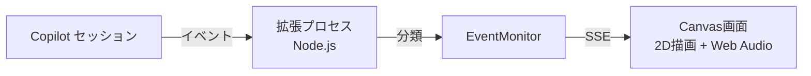

この記事のテーマはネタです。技術部分は真面目な記事です。この記事に限り、AIで生成しています。

まずはこちらをご覧ください。

https://x.com/07JP27/status/2108929419889062200?s=20

GitHub Copilot Appがファイルを読んだり、書き換えたり、コマンドを実行したりするたびに、ソシャゲのような派手な演出と効果音で実況してくれるCanvas「**DopaCopa**」を作ってみました。名前は「ドーパミンが出るCopilot」の意味です。（上記の動画はこの記事を書かせたときの様子です）

AIが裏で何をしているかが一目で分かる実用的な……ものではなく、純粋に**気持ちよく、やかましく**することだけを目指しています。とはいえ動画にもあるようにイベント履歴を一覧表示する機能もあり、実用的な部分も……あるかどうかは皆様の判断におまかせします。

この記事では、これを実現しているCanvasの仕組みと、作る過程でやったことを紹介します。インストール方法も記載しているので、試してみたい方は[インストール](#インストール)へどうぞ。

## Canvasとは
GitHub Copilot Appで、チャットの右側パネルに自分専用のUIを表示できる機能です。カンバンやダッシュボードのようなものを開いて、人とAIが同じ画面を操作できます。
https://docs.github.com/en/copilot/how-tos/github-copilot-app/working-with-canvas-extensions

実体は拡張機能で、`/create-canvas`でCopilotに依頼すれば作ってもらえます。個人用なら`~/.copilot/extensions`に保存され、次のセッションでも使えます。
今回のDopaCopaも、「Copilotの動きを実況する派手なCanvasを作って」とお願いするところから始め、あとはチャットで見た目や音の注文を出し続けて作りました。コードはほぼCopilotが書いています。

## 全体構成
Canvasの正体はローカルで動くWebアプリですが、Copilotからのイベントを直接受け取るのはブラウザではなく、間に入る**Node.jsの拡張プロセス**です。DopaCopaでは次のような流れにしています。



1. 拡張プロセスがセッションのイベントをすべて購読する
2. イベントを「読込」「書換」「探索」などの種類に分類する
3. 拡張プロセスが立てたローカルHTTPサーバーから、SSEでCanvas画面へ配信する
4. Canvas画面が、受け取った種類に応じた演出と効果音を再生する

### イベントを受け取る
拡張側で`joinSession`にイベントのコールバックを渡すと、セッションで起きたことを受け取れます。ツールの実行開始・完了、コンパクション、サブエージェント、使用量、エラーなど、種類はかなり豊富です。

```js
import { joinSession } from "@github/copilot-sdk/extension";

const session = await joinSession({
    canvases: [canvas],
    streaming: true,
    includeSubAgentStreamingEvents: true,
    onEvent: receive,
});
```

`streaming: true`を指定すると、推論や応答のストリーミング中のイベントも届きます。これのおかげで、モデルが考えている間もずっと画面が動き続けます。

「トークンが余計にかかるのでは？」と心配になるかもしれませんが、DopaCopaはイベントを受け取って画面に表示するだけで、モデルへの問い合わせは一切しません。増えるとすれば、Canvasの説明文がコンテキストに数行加わる程度です。

### イベントを演出に変換する
受け取ったイベントは、種類ごとに「何が起きているか」へ変換します。ツール名から読込・書換・探索・実行のどれかを判定し、それ以外のイベントはイベント名で分類します。中央に大きく出る文字との対応は次の通りです。

| 起きていること | 表示文字 |
|---|---|
| モデル呼び出し・推論 | 推論 |
| 応答テキストの生成 | 生成 |
| ファイル・データの読み込み | 読込 |
| 検索・ファイル探索・コード解析 | 探索 |
| ファイルの作成・編集・削除 | 書換 |
| シェル・コマンド実行 | 実行 |
| コンテキストのコンパクション | 圧縮 |
| サブエージェントの起動 | 参戦 |
| 権限確認・ユーザー入力要求 | 確認 |
| ツール失敗・モデルエラー | 失敗 |

読込・書換・探索のときは対象のファイル名、実行のときはコマンド名、参戦のときはエージェント名も一緒に表示します。

画面の隅には、接続状態の`Connected`、ツールを実行した回数の`RUSH`、入力と出力の合計トークン数の`TOTAL TOKENS`を常に出しています。`RUSH`は新しい指示ごとに0へ戻り、ツールの実行開始1回につき1つ増えます。いわゆる連撃カウンターです。数字はカウントアップのアニメーション付きです。

### 画面と音
画面は黒背景に金・ネオンの装飾をまとったCanvas 2Dの描画で、文字は窓に収まるサイズのまま、周りの衝撃波や粒子、枠の装飾でド派手にしています。
音はWeb Audioで再生します。ソシャゲの演出のように、「溜め（ダッシュ音など）→ 着弾（シャキーン・金属音・爆発音）→ 余韻（キラキラ音）」の3段階を重ね、種類ごとに音の組み合わせを変えています。たとえば読込は「シャキーン」、書換は金属音、コマンド実行は爆発音が着弾音になります。

## こだわったところ
### 「開始」も「完了」も出さない
最初のバージョンには、開始ボタンや「完了」「応答待ち」の表示がありました。しかしCanvasを開けば自動で接続されてイベントが流れてくるので、開始ボタンは不要です。また、演出が出ている間が処理中で、出なくなったら終わりなので、完了や待機をわざわざ表示する必要もありません。
状態を文字で説明するのをやめたことで、画面が演出だけに集中するようになりました。

### 効果音は素材に差し替えた
最初はコードで音を合成して鳴らしていたのですが、結果は気の抜けた「ボッスボッス」という音で、ドーパミンは全然出ませんでした。別のAIに音源の生成を頼むための指示書をCopilotに書いてもらうなどもしましたが、最終的には、効果音素材のmp3を16種類用意して差し替えました。
音のクオリティは演出の気持ちよさに直結するので、ここは素材の力に頼るのが正解でした。素材は[効果音ラボ](https://soundeffect-lab.info/)のものを使っています。

### 中身は収集しない
画面に出すのは「何をしているか」だけにしています。

- 推論の中身や応答の本文は収集しない
- ファイルの中身は収集しない（ファイルパスとツール名は履歴に保存されます）
- コマンドは認証情報が含まれる可能性があるため、引数を捨てて実行ファイル名だけを使う
- Canvasのサーバーは`127.0.0.1`のランダムなポートで待ち受け、トークンとHostヘッダーを検証する

派手な見た目ですが、画面共有で見せても本文が漏れないようにしています。

## おまけ：Canvasはエージェントからも操作できる
Canvasにはエージェントが呼び出せるアクションを登録できます。DopaCopaでは、受信したイベントの集計を返す`get_status`と、直近のイベント履歴を返す`get_recent_events`を用意しています。
「今のCanvasの状態を教えて」と頼むと、Copilot自身が自分の実況ログを読みに行く、という妙な構図が成立します。

履歴はセッションのワークスペースに保存しているため、Canvasを開き直しても引き継がれます。

## インストール
DopaCopaはGitHubでMITライセンスの下、公開しています。ぜひ手元のGitHub Copilot Appもやかましくしてみてください。
https://github.com/07JP27/DopaCopa

GitHub Copilot App 1.0.94-3 / macOSで開発しています。拡張SDKは実験的なため、他のバージョンやOSでの動作は未確認です。

1. [Releases](https://github.com/07JP27/DopaCopa/releases)から配布用のZIPとSHA256SUMSをダウンロードする（自動生成される「Source code」のZIPではありません）
2. ZIPを展開し、中の`copilot-arcade/`フォルダを`~/.copilot/extensions/copilot-arcade/`に配置する
3. Copilotに「拡張機能を再読み込みして」、続けて「DopaCopaを開いて」と依頼する

npmパッケージのインストールなどは不要です。詳しい手順はリポジトリのREADMEを参照してください。
なお、効果音のmp3はMITライセンスの対象外で、効果音ラボの利用条件に従います。

## まとめ
GitHub Copilot Appがやっていることは、イベントとして外から眺められます。それを使えば、通知装置にも、ダッシュボードにも、今回のようなやかましい実況にもできます。
実用性を問われると困りますが、AIの待ち時間が少し楽しくなるので、ぜひ自分だけのCanvasを作ってみてください。

それでは良いGitHub Copilotライフを！
