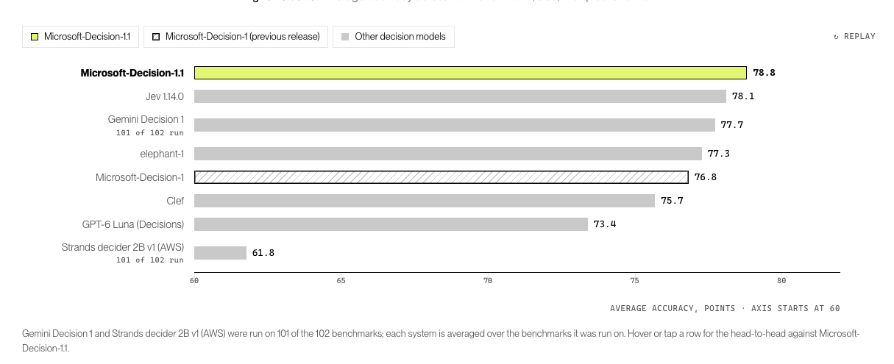
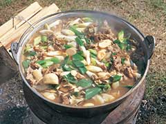

先月、Microsoft純正のDecisionモデル「Microsoft-Decision-1」を紹介する記事を書きました。
https://zenn.dev/microsoft/articles/ms-decision-1

それから約1か月、早くも後継の「Microsoft-Decision-1.1」が一般提供（GA）になりました。
https://commandline.microsoft.com/microsoft-decision-model-ga/

発表では「1の2倍以上速い」「精度とキャリブレーションが向上」「画像入力に対応」とされています。ただ、手元から呼んだときにどれくらい差があるのかは、実際に叩いてみないとわかりません。
そこで本記事では、同じFoundryリソースに1と1.1をデプロイして同じリクエストを送り、スピードと回答の品質を比べてみました。

以降、Microsoft-Decision-1を「1」、Microsoft-Decision-1.1を「1.1」と表記します。

## 1.1で何が変わったのか
公式の発表内容を1と比べると、以下のとおりです。

|項目|1|1.1|
|---|---|---|
|提供状況|パブリックプレビュー|一般提供（GA）|
|ベースモデル|Qwen3.5-9B|Gemma 4 26B A4B（MoE）|
|速度|-|1の2倍以上|
|入力|テキスト|テキスト＋画像|
|入力価格（Global Standard、100万トークンあたり）|$0.042|$0.042|
|出力価格|無料|無料|
|Artificial Analysis Decision Index v2.1|62|68|


このほか、Microsoftによる評価では、学習に使っていない102個のベンチマーク（38万5千問以上）での平均正解率が78.8%と、比較した8つのDecisionモデルの中で最も高かったそうです。
注目したいのは、**Decisionモデルの元祖Jevに匹敵するか、それ以上の結果を出している**点です。


*出典：[Microsoft公式発表](https://commandline.microsoft.com/microsoft-decision-model-ga/)*

価格は据え置きのまま、速く・賢くなったという触れ込みです。

APIのエンドポイントとリクエストの形式は1と同じで、`model`に指定するデプロイ名を変えるだけで呼び分けられます。公式の技術ドキュメントも1.1の内容に更新されています。
https://learn.microsoft.com/ja-jp/azure/foundry/foundry-models/how-to/use-foundry-models-microsoft-decision

## 検証条件
2026年11月19日に、以下の条件で検証しました。

- Microsoft Foundryのリソース（East US 2）に、1と1.1をそれぞれGlobal Standardでデプロイ
- 日本国内の端末から、スクリプトで呼び出し
- 時間はクライアント側で計測した往復時間（ネットワーク込み）。各シナリオの初回はウォームアップとして除外

なお、Global Standardでは推論するリージョンがリクエストごとに決まります。レスポンスヘッダーの`azureml-destination-region`を記録したところ、今回は1が`centralus`、1.1が`southcentralus`で、記録した範囲ではどちらも変わりませんでした。

## 検証1：スピード
### 普段使いのサイズ
前回記事のサンプルに近い問い合わせ文（「本日、アカウントの支払いが2回失敗しました。今日中に対応をお願いしたいのですが。」）を使い、以下の5パターンをそれぞれ30回ずつ呼び出しました。

- noul・choice・scoreの各タイプを1問ずつ
- 3タイプの質問を1リクエストにまとめたもの
- Stateに問い合わせ履歴を足して長くしたもの（約2,400トークン、質問はchoice）

|シナリオ|入力トークン|1 p50|1.1 p50|1 p95|1.1 p95|
|---|---|---|---|---|---|
|noul|45|292|289|440|391|
|choice|71|304|283|415|371|
|score|約54|330|292|420|418|
|3問まとめて|約124|341|296|501|409|
|長いState|約2,400|349|307|505|389|

（単位：ミリ秒）

すべてのシナリオで1.1のほうが速いものの、p50の差は3〜45ミリ秒程度です。倍率にすると1.01〜1.15倍です。

### 通信時間を差し引くと
日本から米国のリソースまでの往復だけでも、それなりに時間がかかります。そこで、認証ヘッダーを付けずに同じエンドポイントへリクエストを送り、401が返ってくるまでの時間を通信時間の目安として測りました。
結果は1・1.1ともにp50で165〜168ミリ秒でした。つまり、上の往復時間（約290〜350ミリ秒）のうち、半分ほどは通信時間です。

これを差し引くと以下のようになります。

|シナリオ|1|1.1|1 ÷ 1.1|
|---|---|---|---|
|noul|124|124|1.00|
|choice|136|118|1.15|
|score|162|127|1.28|
|3問まとめて|174|131|1.33|
|長いState|181|142|1.27|

（単位：ミリ秒、p50から通信時間のp50を引いた値）

差し引いても1.00〜1.33倍でした。
なお、401は推論リージョンへ転送する前に返っていると考えられるため、差し引いた時間には推論リージョンまでの通信も含まれます。前述のとおり1と1.1で推論リージョンが違うので、あくまで目安として見てください。

### 入力を長くすると
Decisionモデルは長い入力をまとめて判定する用途も想定されているので、Stateを約8K・16K・30Kトークンまで伸ばして（質問はchoice）、同じように30回ずつ比較しました。

|入力トークン|1 p50|1.1 p50|1 p95|1.1 p95|通信時間を除いたp50の比（1 ÷ 1.1）|
|---|---|---|---|---|---|
|8,153|389|359|529|463|1.14|
|16,253|479|432|732|550|1.17|
|29,753|704|602|840|637|1.23|

（単位：ミリ秒）

入力が長くなるほど差は広がり、約30Kトークンではp50で約100ミリ秒、p95で約200ミリ秒の差になりました。p95の差のほうが大きいので、1.1は応答時間のばらつきも小さいと言えます。
とはいえ、今回の条件では2倍の差は確認できませんでした。公式発表には速度の測定条件が見当たらなかったため、同時リクエスト数などの条件によっては結果が変わるかもしれません。
公式が言及している「2倍以上」は、通信やリクエストなどの条件が整ったときのベストパフォーマンスの値のように見えます。

:::message
**入力上限とエラーの違い**

入力の上限はどちらも約32Kトークンですが、超えたときのエラーの返し方が違います。
1はHTTP 422で、以下のエラーが返ってきます。

```json
{"detail":"invalid model request: Question prompt exceeds the 32768-token context limit including the decision token"}
```

1.1はHTTP 413で、以下のエラーが返ってきます。

```json
{"error":"question_context_limit","detail":"question_context_limit","processed_input_tokens":33746,"question_processed_input_tokens":33746,"max_question_processed_input_tokens":32767}
```

ステータスコードで分岐するエラー処理を書いている場合は、乗り換え時に見直しが必要です。
:::


## 検証2：回答の品質
### 使ったデータセット
日本語の公開データセットから、Decisionモデルの3つのタイプに合うものを選びました。各タスク150件を同じシード値で抽出し、1と1.1に同じリクエストを送っています。

|type|データセット|内容|
|---|---|---|
|noul|[JCoLA](https://github.com/osekilab/JCoLA)|日本語の文が文法的に自然かどうか|
|choice|[JNLI（JGLUE）](https://github.com/yahoojapan/JGLUE)|前提の文と仮説の文の関係が含意・矛盾・中立のどれか|
|score|[JSTS（JGLUE）](https://github.com/yahoojapan/JGLUE)|2つの文の意味がどれくらい近いか（0〜5）|

たとえばJNLIでは、以下のように前提と仮説をStateに入れ、関係をchoiceで聞いています。

```json
{
  "model": "Decision-1.1",
  "state": "前提: （前提の文）\n仮説: （仮説の文）",
  "questions": {
    "q": {
      "type": "choice",
      "instructions": "前提と仮説の関係はどれですか？",
      "criteria": {
        "entailment": "前提が正しければ、仮説も必ず正しい",
        "contradiction": "前提が正しければ、仮説は必ず誤り",
        "neutral": "前提だけでは仮説が正しいかどうか決まらない"
      }
    }
  }
}
```

正解率に加えて、以下の指標も算出しました。

- MCC（マシューズ相関係数）：ラベルの偏りに強い2値分類の指標。-1〜1で、1に近いほど良い
- AUC：しきい値によらない判別力。0.5〜1で、1に近いほど良い
- ECE（Expected Calibration Error）：モデルが出した確率と実際の正解率のずれ。0に近いほど確率をそのまま信用できる（選ばれた答えの確率を10区間に分けて算出）
- Pearson・Spearman：予測したスコアと正解スコアの相関。1に近いほど良い

### 結果

|タスク（type）|指標|1|1.1|
|---|---|---|---|
|JCoLA（noul）|正解率|81.3%|80.7%|
||MCC|0.329|0.508|
||AUC|0.833|0.886|
||ECE|0.060|0.022|
|JNLI（choice）|正解率|90.0%|89.3%|
||ECE|0.069|0.035|
|JSTS（score）|Pearson|0.901|0.904|
||Spearman|0.862|0.869|

正解率はほぼ互角で、JCoLA・JNLIともに150件中1件の差しかありません。JSTSの相関もほぼ同じでした。一方で、それ以外の指標でははっきり差が出ました。

**JCoLAの判別力**
今回抽出した150件のうち126件は「自然な文」なので、すべて「自然」と答えるだけでも正解率は84.0%になります。両モデルとも正解率はこれを下回っていますが（noulの値を0.5で区切った場合）、ラベルの偏りに強いMCCやAUCでは1.1が明確に上回りました。不自然な文を見分ける力は1.1のほうが上と言えそうです。

**キャリブレーション**
ECEはJCoLAで約3分の1、JNLIで約半分になりました。1.1が出す確率は、実際の当たりやすさとよく一致しているということです。確率をしきい値にして「自動で処理する」「人に回す」を切り替えるような使い方では、この差は有効に働くことが期待できます。

**JNLIの答え方の傾向**
正解率は同じでも、内訳を見ると傾向が違います。

|正解ラベル|件数|1の正解数|1.1の正解数|
|---|---|---|---|
|含意|24|18|23|
|矛盾|45|39|32|
|中立|81|78|79|

1.1は含意をよく当てる一方、矛盾を中立と答えるケースが増えていました（1は5件、1.1は12件）。


## 検証3：芋煮ベンチマーク
[前回記事と同じく](https://zenn.dev/microsoft/articles/ms-decision-1#%E3%82%B5%E3%83%B3%E3%83%97%E3%83%AB)、Stateに以下の主張を入れて、正しいかどうかを聞きました。それぞれ5回ずつ呼び出した平均です。

```txt:State
"芋煮"の定義は牛肉と醤油と里芋が入っていることが絶対条件である。
```

|聞き方|1|1.1|
|---|---|---|
|noul（yesの確率）|0.6%|5.3%|
|choice（yes / no / not_sure）|1.8% / 97.7% / 0.5%|8.3% / 78.7% / 13.0%|
|noul＋「山形県内陸民として考えてください。」|6.0%|54.4%|

素の状態では、1.1でもまだ「いいえ」が優勢です。ただ、1がほぼ「いいえ」と断定していたのに対して、1.1はchoiceで「わかりません」を13.0%選んでおり、断定を避けるようになりました。

**そしてなんと**、インストラクションで山形県内陸民になりきってもらうと、1は6.0%止まりでしたが、1.1は54.4%と過半数が「はい」になりました。
ついに山形県内陸民の気持ちをわかってくれるようになったようです。
**素晴らしい 1.1！ もう 1.1 しか勝たん。**


## 検証4：画像入力（1.1のみ）
1.1では画像も入力できるようになりました。`assets`にBase64エンコードした画像を入れ、Stateなどから`image:<名前>`の形式で参照します。

せっかくなので、写真の芋煮が山形内陸風かどうかを判定させてみます。用意したのは以下の2枚です。1枚目が正真正銘の芋煮、2枚目が豚汁（引用元で「山形庄内風芋煮」として紹介されているもの）です。

|1枚目（芋煮）|2枚目（豚汁）|
|:---:|:---:|
|||

[引用元](https://www.yamagata.nmai.org/m/perorin_syun/vol049/)

写真だけでは肉や調味料を見分けられないこともあるため、choiceには「写真だけでは判断できない」も入れています。また、ファイル名が判定のヒントにならないよう、`photo1.png`・`photo2.png`という名前で送りました。

```json
{
  "model": "Decision-1.1",
  "state": "写真: image:photo1.png",
  "assets": {
    "photo1.png": {"type": "image", "format": "png", "data_base64": "<Base64エンコードした画像>"}
  },
  "questions": {
    "yamagata": {"type": "noul", "instructions": "この芋煮は山形内陸風（牛肉・醤油ベース）ですか？"},
    "style": {
      "type": "choice",
      "instructions": "この芋煮はどの地域の芋煮に近いですか？",
      "criteria": {
        "yamagata_inland": "牛肉・醤油ベース（山形内陸風）",
        "shonai_miyagi": "豚肉・味噌ベース（庄内・宮城風）",
        "not_imoni": "芋煮ではない",
        "not_sure": "写真だけでは判断できない"
      }
    }
  }
}
```

:::message
**画像サイズの下限**

最初は写真をそのまま送ったところ、以下のエラーで拒否されました。

```json
{"error":"invalid_image","detail":"invalid_image","message":"asset 'photo1.png' is 240x180; each side must be at least 280 pixels"}
```

画像は縦横それぞれ280ピクセル以上が必要なようです。今回は縦横比を保ったまま、373×280に拡大してから送りました。なお、入力トークンは画像込みで386でした。
:::

### 判定結果
**noul：山形内陸風か？**

|質問|1枚目（芋煮）|2枚目（豚汁）|
|---|---|---|
|山形内陸風である（yesの確率）|59.9%|48.9%|

**choice：どの地域の芋煮に近いか（選択肢ごとの確率）**

|選択肢|1枚目（芋煮）|2枚目（豚汁）|
|---|---|---|
|牛肉・醤油ベース（山形内陸風）|21.3%|30.8%|
|豚肉・味噌ベース（庄内・宮城風）|**41.1%**|24.8%|
|芋煮ではない|6.1%|11.8%|
|写真だけでは判断できない|31.5%|**32.6%**|

noulでは1枚目のほうが山形内陸風と判定される確率が高く、かなりの僅差ですが半分の50%を閾値とした場合に「芋煮か、それ以外か」を判断できていることになります。

#### だがここで問題が発生
なんとchoiceでは、芋煮を豚汁（庄内・宮城風）と判定しました。

**芋煮会出禁にすんぞ 1.1！**


まぁ元の写真は240×180と小さいので、肉の種類や汁の色を見分けるのは難しかったのかもしれません。どちらの写真でも最も高い選択肢が41.1%以下にとどまっており、判断の難しさは確率に表れています。今回は特別に許してやるぞ1.1。

## まとめ
- 速度：すべてのシナリオで1.1のほうが速かったものの、日本から呼ぶと通信時間の割合が大きく、普段使いのサイズでは往復時間で1.01〜1.15倍の差にとどまりました。入力が長くなるほど差は広がり、p95も安定します。今回の条件では公式発表にある「2倍以上」は確認できませんでした。日本リージョンでの提供が待たれます。
- 品質：少なくとも今回測定した日本語ベンチマークでは、正解率はほぼ互角です。一方で、判別力（MCC・AUC）とキャリブレーション（ECE）ははっきり改善していました。
- 芋煮ベンチ：山形県内陸民の気持ちを、半分くらいわかってくれるようになりました。ただ、写真から正真正銘の芋煮を見分けるのはまだ難しいようです。

価格が同じで確率の信頼性が上がっていますし、1.1のほうが先にGAしていることも踏まえると、これから使うなら1.1を選ばない理由はなさそうです。すでに1を使っている場合も、確率をしきい値にして処理を分けている箇所から乗り換えると効果を感じやすいと思います。

## 付録：検証スクリプト
検証に使ったスクリプトは全体で約600行あるため、呼び出しと計測の中心部分だけを抜粋します。
アクセストークンは`az account get-access-token --resource https://cognitiveservices.azure.com`で取得し、環境変数に入れています。

```python
import http.client
import json
import os
import time

HOST = os.environ["AZURE_HOST"]  # 例: <リソース名>.services.ai.azure.com
PATH = "/providers/microsoft/v1/systemone"
TOKEN = os.environ["AZURE_ENTRA_TOKEN"]
conn = http.client.HTTPSConnection(HOST, timeout=60)  # 接続を使い回す


def call(deployment, state, questions):
    body = {"model": deployment, "state": state, "questions": questions}
    payload = json.dumps(body, ensure_ascii=False).encode("utf-8")
    headers = {"Content-Type": "application/json", "Authorization": f"Bearer {TOKEN}"}
    start = time.perf_counter()
    conn.request("POST", PATH, payload, headers)
    resp = conn.getresponse()
    raw = resp.read()
    latency_ms = (time.perf_counter() - start) * 1000
    region = resp.getheader("azureml-destination-region")
    return resp.status, latency_ms, region, json.loads(raw)


questions = {"q": {"type": "noul", "instructions": "Stateの主張は正しいですか？"}}
state = "\"芋煮\"の定義は牛肉と醤油と里芋が入っていることが絶対条件である。"
for deployment in ["Decision-1", "Decision-1.1"]:
    print(deployment, call(deployment, state, questions))
```

実際のスクリプトでは、このほかに呼び出し順のランダム化、ウォームアップの除外、レート制限に合わせた待機、レスポンスの検証、結果の保存と集計をしています。
