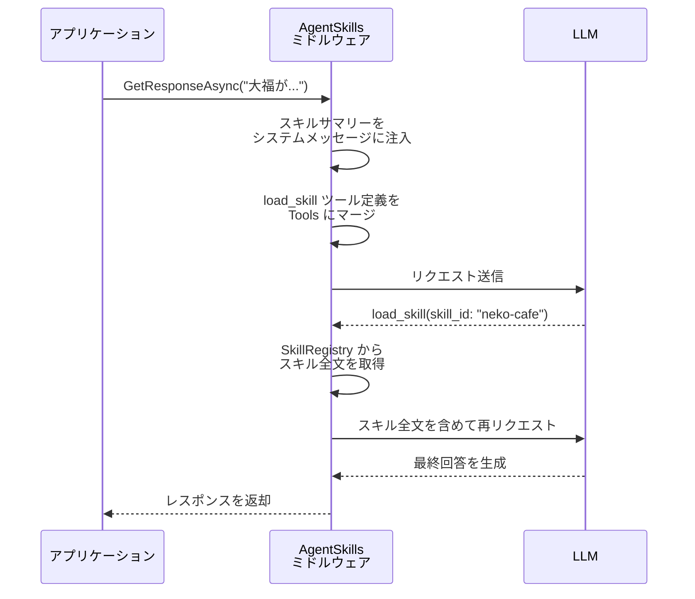

最近、AIエージェントに「スキル」という形でドメイン知識を渡すエコシステムが急速に広がっています。[Agent Skills](https://agentskills.io/) はAnthropicが主導して発表したオープンスタンダードで、エージェントが必要に応じて手続き的な知識やチーム固有のコンテキストをオンデマンドでロードできる仕組みを定義しています。すでに Claude、Codex、GitHub Copilot をはじめとする多くのエージェント製品が対応済みで、スキルを一度書けば複数のエージェントで使い回せる世界が現実になりつつあります。

.NETの世界でも、2026年3月2日に[Microsoft Agent FrameworkがSkillsに対応しました](https://devblogs.microsoft.com/agent-framework/give-your-agents-domain-expertise-with-agent-skills-in-microsoft-agent-framework/)。一方で、もう一つの主要な.NET AIライブラリである Microsoft.Extensions.AI（MEAI）にはSkillsの仕組みが実装されていません。Microsoft Agent Frameworkの対応から「SkillsはAgentレイヤーで担うもの」という考えがうかがえますが、Microsoft Agent Frameworkはオーケストレーションやワークフローまで含む本格的なエージェントフレームワークなので、「単にIChatClientにSkillsを足したいだけ」というケースにはtoo muchです。

というわけで、MEAIのミドルウェアとしてAgent Skillsを使えるようにするライブラリを作りました。

https://github.com/07JP27/MEAI_SkillsAddon

この記事では、ライブラリの使い方と、なぜMEAIのミドルウェアパイプラインでこのようなことが実現できるのかという仕組みの部分まで解説していきます。

## おさらい：Agent Skillsとは

[Agent Skills](https://agentskills.io/) は、AIエージェントに**手続き的な知識や専門的なドメイン知識**をオンデマンドで提供するためのオープンスタンダードです。

具体的には、フォルダ単位でスキルを管理し、各スキルは `SKILL.md` というMarkdownファイルで構成されます。YAML frontmatter に `name` と `description` を記述し、本文にエージェントへの詳細な指示を書く、とてもシンプルな構造です。

```markdown
---
name: neko-cafe
description: 猫カフェ運営マニュアル。メニュー、猫の性格、接客ルール、トラブル対応をカバー。
---

# 猫カフェ運営マニュアル

## トラブル対応
...（詳細な手順）
```

このスタンダードが嬉しいのは、関わる人全員にメリットがあることです。

- **スキル作者**: 一度書けば、対応するエージェント製品すべてで利用可能
- **エージェント製品**: Skillsサポートを実装するだけで、ユーザーが持つスキル資産をすぐに活用可能
- **チーム・企業**: 組織固有のナレッジをバージョン管理可能なパッケージに落とし込める

## Microsoft.Extensions.AI（MEAI）とは

[Microsoft.Extensions.AI](https://learn.microsoft.com/dotnet/ai/microsoft-extensions-ai)は、.NETで生成AIサービスと統一的にやり取りするための抽象化レイヤーです。中心となるのは `IChatClient` インターフェイスで、Azure OpenAI、OpenAI、Ollama などさまざまなAIサービスに対して同一のAPIでチャットのやり取りができるようになります。

そしてMEAIの大きな特徴が**ミドルウェアパイプライン**です。ASP.NETのミドルウェアに馴染みがある方ならピンとくると思いますが、`ChatClientBuilder` を使って `IChatClient` のパイプラインにミドルウェアを積み重ねることで、OpenTelemetryによるテレメトリ、キャッシュ、ツールの自動呼び出しなどの横断的関心事を、アプリケーションコードを変更せずに差し込むことができます。

```csharp
builder.Services
    .AddChatClient(/* any IChatClient */)
    .UseOpenTelemetry()        // テレメトリ
    .UseDistributedCache()     // キャッシュ
    .UseFunctionInvocation();  // ツール自動呼び出し
```

このミドルウェアパターンを今回のライブラリでも使用しています。MEAIのパイプラインに「もう一層」ミドルウェアを足すだけで、Agent Skillsの機能を透過的に追加できるというわけです。

## クイックスタート

### 1. スキルファイルを作成する

まず、スキルをフォルダとして用意します。Agent Skills仕様に準拠した `SKILL.md` を配置するだけです。

```
skills/
├── neko-cafe/
│   └── SKILL.md    ← 猫カフェ運営マニュアル
└── expense-bot/
    └── SKILL.md    ← 社内経費精算ルール
```

各 `SKILL.md` には `name` と `description` を含む YAML frontmatter を記述します。`description`（最大200文字）がスキル要約として LLM に提示されます。

```markdown
---
name: neko-cafe
description: 架空の猫カフェ「にゃんぱらだいす」の運営マニュアル。メニュー、猫の性格、接客ルール、トラブル対応など。
---

# にゃんぱらだいす 運営マニュアル

詳細な指示をここに記述...
```

### 2. ミドルウェアを組み込む

MEAIの `ChatClientBuilder` に `.UseAgentSkills()` を追加するだけで準備完了です。

```csharp
using MEAI_SkillsAddon;
using Microsoft.Extensions.AI;
using Microsoft.Extensions.DependencyInjection;
using Microsoft.Extensions.Hosting;

var builder = Host.CreateApplicationBuilder(args);

AzureOpenAIClient azureClient = new(
    new Uri("https://{your-resource-name}.openai.azure.com/"),
    new DefaultAzureCredential());

builder.Services
    .AddChatClient(azureClient.GetChatClient("gpt-5.2").AsIChatClient())
    .UseAgentSkills(skills => skills
        .AddLocalFolder("./skills")
        .Configure(opt =>
        {
            opt.MaxIterations = 5;
            opt.OnSkillsDiscovered = ctx =>
                Console.WriteLine($"[Skills] {ctx.Skills.Count} skills discovered in {ctx.DiscoveryDuration.TotalMilliseconds:F0}ms");
            opt.OnSkillLoaded = ctx =>
                Console.WriteLine($"[Skill] {ctx.SkillId} loaded in {ctx.LoadDuration.TotalMilliseconds:F0}ms");
        }));

var app = builder.Build();

var chat = app.Services.GetRequiredService<IChatClient>();
var response = await chat.GetResponseAsync("大福がお客さんのバッグを漁ってしまいました。どうすればいいですか？");
Console.WriteLine(response.Text);
```

`AddChatClient` にはお好みのAIサービスの `IChatClient` 実装を渡してください（Azure OpenAI、OpenAI、Ollama など）。あとは `.UseAgentSkills()` を1行追加すれば、既存のコードを一切変更せずにSkills機能が有効になります。

### 3. 実行結果（1ターンの会話）

上記コードを実行すると、以下のような出力が得られます。

```
[Skills] 2 skills discovered in 84ms
[Skill] neko-cafe loaded in 5ms
マニュアルの「大福がお客様の鞄を漁った場合」手順で対応してください。

1) 落ち着いて大福をバッグから引き離す（おやつで誘導して距離を取る）  
2) お客様にすぐ謝罪し、「にゃんこ焼き」1個をサービスする  
3) 今後の再発防止として、貴重品ロッカー利用を改めて案内する
```

注目していただきたいのは `[Skills] 2 skills discovered` と `[Skill] neko-cafe loaded` のログです。ライブラリが2つのスキルを発見し、LLMが質問内容から判断して `neko-cafe` スキルだけをロードしていることがわかります。全スキルの詳細を毎回コンテキストに詰め込むのではなく、**必要なスキルだけをオンデマンドで読み込む**ことでコンテキストウィンドウを効率的に使えるのが大きなポイントです。

### 4. マルチターン会話

マルチターンの会話でもスキルは自然に機能します。2ターン目で話題が変わっても、LLMが自動的に適切なスキルをロードしてくれます。

```csharp
var messages = new List<ChatMessage>();

// 1ターン目
var userMessage1 = "午前中にツナを触ろうとしたらシャーって怒られたんだけど、なんで？";
Console.WriteLine($"> {userMessage1}\n");
messages.Add(new ChatMessage(ChatRole.User, userMessage1));
var response1 = await chat.GetResponseAsync(messages);
Console.WriteLine(response1.Text);
messages.AddRange(response1.Messages);

Console.WriteLine("\n─────────────────────────────────────────\n");

// 2ターン目 — スキルロード履歴が引き継がれる
var userMessage2 = "そうなんだ。ところでさっきの店にチームで行く費用って会社の経費で落とせる？6人分だといくらくらいになるかな";
Console.WriteLine($"> {userMessage2}\n");
messages.Add(new ChatMessage(ChatRole.User, userMessage2));
var response2 = await chat.GetResponseAsync(messages);
Console.WriteLine(response2.Text);
```

出力はこのようになります。

```
> 午前中にツナを触ろうとしたらシャーって怒られたんだけど、なんで？

[Skills] 2 skills discovered in 87ms
[Skill] neko-cafe loaded in 2ms
ツナは「午前中は機嫌が悪い」タイプのツンデレで、運営マニュアルでも
**13時以降の触れ合い推奨**になってる子なんだ。だから午前中に手を出すと
「今はやめて」って警告でシャーしやすい。

対策は、午前中は無理に触らず **近くで静かに見守る／猫のほうから寄ってきた
時だけ短く撫でる** のが安全。触るなら13時以降が成功率高いよ。

─────────────────────────────────────────

> そうなんだ。ところでさっきの店にチームで行く費用って会社の経費で落とせる？
  6人分だといくらくらいになるかな

[Skill] expense-bot loaded in 1ms
条件次第で落とせます。社内ルール的には、猫カフェ代は多くの場合
**「会議費（社外打ち合わせの飲食）」扱い**で申請するのが近いです
（業務目的が説明できることが前提）。

（省略 — 経費精算ルールに基づいた詳細な回答が続く）
```

1ターン目では猫カフェスキル、2ターン目では経費精算スキルが**それぞれ必要なタイミングで自動ロード**されています。ポイントは `response.Messages` を履歴にそのまま追加していることです。この `Messages` にはスキルロードに使われたツール呼び出しの中間メッセージも含まれるため、LLMはどのスキルがすでにロード済みかを把握でき、同じスキルを重複して読み込むことがありません。

サンプルのフルコードは[リポジトリのSampleプロジェクト](https://github.com/07JP27/MEAI_SkillsAddon/tree/main/MEAI_SkillsAddon.Sample)で公開しています。

## 特徴

ここからはライブラリの特徴をもう少し掘り下げていきます。

### MEAIパイプラインへのシームレスな統合

このライブラリはMEAIの `DelegatingChatClient` を継承した正規のミドルウェアとして実装されているため、他のMEAIミドルウェアと自然に組み合わせることができます。

```csharp
builder.Services
    .AddChatClient(/* IChatClient */)
    .UseOpenTelemetry()     // テレメトリ
    .UseAgentSkills(skills => skills
        .AddLocalFolder("./skills"))
    .UseFunctionInvocation(); // 他のツール自動呼び出し
```

既存のMEAIパイプラインに `.UseAgentSkills()` を1行足すだけなので、導入のハードルは非常に低いです。

### スタートアップでのスキル登録

スキルソースの登録はFluent APIのビルダーパターンで記述します。

```csharp
.UseAgentSkills(skills => skills
    .AddLocalFolder("./skills")                           // ローカルフォルダ
    .AddLocalFolder("./more-skills", skillFileName: "INSTRUCTIONS.md") // ファイル名変更も可能
    .AddSource(new BlobSkillSource(blobUri))               // カスタムソース（インスタンス）
    .AddSource<DatabaseSkillSource>()                      // カスタムソース（DI解決）
    .Configure(opt =>
    {
        opt.MaxIterations = 5;
        opt.OnSkillsDiscovered = ctx => { /* ... */ };
        opt.OnSkillLoaded = ctx => { /* ... */ };
    }))
```

複数のソースを組み合わせて使用できます。同一スキルIDが複数のソースに存在する場合は、先に登録されたソースが優先されます。

### ISkillSourceでのカスタムの読み込み元サポート

ローカルフォルダ以外からスキルを読み込みたい場合は、`ISkillSource` インターフェイスを実装するだけです。実装が必要なのは以下の2メソッドだけなので非常にシンプルです。

```csharp
public interface ISkillSource
{
    // スキルID＋要約のリストを返す（初回に1度だけ呼ばれる）
    Task<IReadOnlyList<SkillSummary>> GetSummariesAsync(CancellationToken ct = default);

    // IDに対応するスキルの全文を返す（LLMがload_skillを呼んだ時に実行される）
    Task<string> GetContentAsync(string skillId, CancellationToken ct = default);
}
```

たとえばAzure Blob Storageからスキルを読み込む実装は、サンプルプロジェクトに [BlobSkillSource](https://github.com/07JP27/MEAI_SkillsAddon/blob/main/MEAI_SkillsAddon.Sample/BlobSkillSource.cs) として含まれています。

```csharp
using MEAI_SkillsAddon.Sample;

// DefaultAzureCredential で自動認証
skills.AddSource(new BlobSkillSource(
    new Uri("https://<account>.blob.core.windows.net/<container>")));
```

データベースやREST API、その他任意のバックエンドからスキルを読み込む実装も、この2メソッドを実装するだけで実現できます。

### コールバックによる可観測性

スキルの発見やロードのタイミングでコールバックを受け取ることができます。

| オプション | 型 | 説明 |
|---|---|---|
| `OnSkillsDiscovered` | `Action<SkillsDiscoveredContext>?` | スキル一覧の初回読み込み完了時に呼ばれる |
| `OnSkillLoaded` | `Action<SkillLoadedContext>?` | スキル読み込み時に毎回呼ばれる |

`SkillLoadedContext` にはスキルID、要約、ロードにかかった時間（`TimeSpan`）が含まれるため、ロギングやパフォーマンス計測に活用できます。クイックスタートのコンソール出力 `[Skill] neko-cafe loaded in 5ms` はまさにこのコールバックを使ったものです。

### スキルキャッシュとリロード

スキルは初回リクエスト時に1度だけスキャンされ、キャッシュされます。通常はこれで十分ですが、実行中にスキルファイルを更新した場合は強制的に再スキャンできます。

```csharp
await chat.ReloadSkillsAsync();
```

## 原理

ここからはこのライブラリがどのように動作しているのか紹介します。
このライブラリ（というかSkillsの）の核心は、必要なスキルだけをオンデマンドでロードしているところです。具体的なフローを見ていきましょう。

### 処理フロー



ポイントはステップ1でスキルの要約（description）だけをLLMに見せていることです。全スキルの詳細を毎回送るとコンテキストウィンドウをすぐに圧迫しますが、要約だけなら最小限のトークンで済みます。LLMは要約を見て本当に必要なスキルだけを `load_skill` で取得するので、コンテキストの使い方が非常に効率的です。


## まとめ

- Microsoft.Extensions.AI（MEAI）のミドルウェアパターンを活用し、Agent Skills規格に準拠したSkill Discovery・Selection・Injectionを実現するライブラリを作成しました
- LLMのTool Useを内部的に利用することで、スキルの要約だけをLLMに提示し、必要なスキルだけをオンデマンドでロードする効率的なアーキテクチャになっています
- `ISkillSource` インターフェイスを実装するだけで、ローカルフォルダだけでなくAzure Blob Storage、データベース、REST APIなど任意のバックエンドからスキルを読み込む拡張が可能です
- MEAIの正規ミドルウェアとして実装されているため、既存のパイプラインに `.UseAgentSkills()` を**1行追加するだけで導入**できます


最後にリポジトリの再掲です。この記事で興味を持っていただいた方は覗いてみてください。
https://github.com/07JP27/MEAI_SkillsAddon
